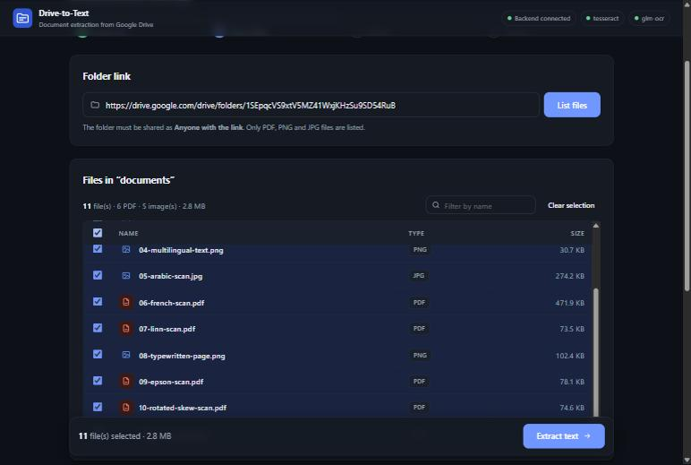
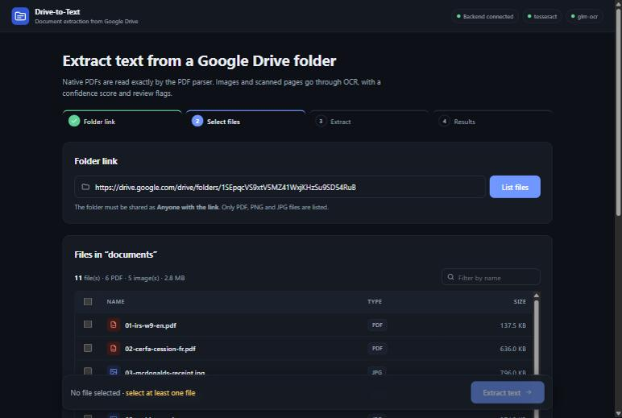
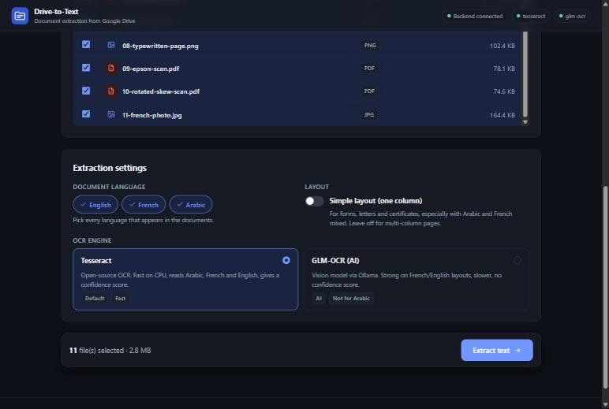

# Drive-to-Text

Paste a public Google Drive folder link, pick the PDFs and images you want, and get their text back: native PDFs are read exactly by a **PDF parser**, images and scanned pages go through **OCR** (Tesseract) with a confidence score and a "needs review" flag. Results show per file and export as JSON.

Built as a proof of concept for the DI Xpertia technical assessment TA-2026-01. Every technical choice is written down with its reason in [docs/DECISIONS.md](docs/DECISIONS.md).



## What it does

| Step | In the app |
|---|---|
| 1. Paste a public Drive link | The link is checked in the browser, then by the server. Invalid, private or missing folders get a clear message. |
| 2. List the documents | Only PDFs and images (PNG, JPG, JPEG) are kept, with name, type and size. Other items are counted as skipped. |
| 3. Select files | Tick files one by one or "Select all"; filter by name. The selected count and size stay visible in a sticky bar. |
| 4. Run the batch | The selected files are processed in the background, 3 at a time. Each file shows *pending*, *processing*, *done* or *failed*, live. One failing file never stops the batch. |
| 5. Read the results | Text per file and per page, the method used (PDF parser, OCR, or both for a PDF with some scanned pages), OCR confidence and review flags. Copy, download as `.txt`, or export the whole batch as JSON. |

Bonus items from the brief, all done: scanned PDFs detected and sent to OCR page by page, asynchronous processing with live progress, Docker Compose, automated tests, and OCR language choice (English, French, Arabic).

Two additions, both small:
- **Confidence and "needs review".** Each OCR page gets Tesseract's confidence (0-100). Pages under 70, pages with no text, and Arabic pages read by the optional AI engine are flagged, so a person knows which results to check.
- **Optional AI OCR engine** (GLM-OCR through a local [Ollama](https://ollama.com)). Off unless Ollama is running; measured and explained below.

## Quick start (Docker, recommended)

Needs [Docker](https://docs.docker.com/get-docker/) and a Google API key (free, see below).

```bash
git clone https://github.com/medaminmakni/drive-to-text.git
cd drive-to-text
cp .env.example .env        # then put your key in GOOGLE_API_KEY
docker compose up --build   # first build: a few minutes
```

Open http://localhost:3000 and paste a public folder link, for example the test folder used for the samples:
`https://drive.google.com/drive/folders/1SEpqcVS9xtV5MZ41WxjKHzSu9SD54RuB`

The images include Tesseract with the English, French and Arabic models, so nothing else needs to be installed.

### Getting a Google API key

The app only reads public folders, so an API key is enough (no user login, no OAuth).

1. In the [Google Cloud Console](https://console.cloud.google.com/), create a project (or use one).
2. *APIs & Services > Library*: enable **Google Drive API**.
3. *APIs & Services > Credentials > Create credentials > API key*. Restrict it to the Google Drive API.
4. Put it in `.env` as `GOOGLE_API_KEY=...`. The `.env` file is git-ignored; never commit it.

## Run without Docker

Backend (Python 3.10+ and Tesseract 5 with the `eng`, `fra` and `ara` models, see [OCR languages](#ocr-languages)):

```bash
pip install -r requirements-dev.txt
uvicorn app.main:app --reload --port 8000     # API docs at http://localhost:8000/docs
```

Web page (Node 20+), in a second terminal:

```bash
cd web
npm ci
npm run dev                                   # http://localhost:3000
```

The page forwards `/api/...` to `http://localhost:8000` (set `API_URL` to change it).

### OCR languages

Tesseract needs one model file per language. The page greys out any language whose model is missing, and the API refuses a batch that asks for it with a clear message.

- **Docker:** all three are installed.
- **Linux:** `sudo apt install tesseract-ocr tesseract-ocr-eng tesseract-ocr-fra tesseract-ocr-ara`
- **Windows** ([UB Mannheim installer](https://github.com/UB-Mannheim/tesseract/wiki)): tick Arabic and French under "Additional language data", or copy `ara.traineddata` and `fra.traineddata` from [tesseract-ocr/tessdata](https://github.com/tesseract-ocr/tessdata) into `C:\Program Files\Tesseract-OCR\tessdata`.

Check with `tesseract --list-langs`, then restart the backend.

## Configuration

All settings live in `.env` (copy [.env.example](.env.example), which documents each one). Only the key is required.

| Variable | Default | Meaning |
|---|---|---|
| `GOOGLE_API_KEY` | (required) | Google API key with the Drive API enabled |
| `MAX_FILE_SIZE_MB` | 25 | Bigger files are marked failed instead of downloaded |
| `MAX_WORKERS` | 3 | Files processed in parallel in one batch |
| `OCR_DEFAULT_LANG` | `eng` | Language when none is chosen (`eng`, `fra`, `ara`, or `ara+fra`...) |
| `PDF_MIN_CHARS_PER_PAGE` | 20 | A PDF page with fewer characters is treated as scanned |
| `OCR_DPI` | 300 | Resolution for rendering scanned PDF pages |
| `OCR_MIN_SIDE_PX` | 1200 | Smaller images are upscaled before OCR (decision 017) |
| `OCR_REVIEW_THRESHOLD` | 70 | OCR pages under this confidence are flagged |
| `OCR_TIMEOUT_S`, `MAX_PDF_PAGES`, `MAX_IMAGE_MEGAPIXELS` | 60, 100, 50 | Limits per file (decision 016) |
| `OMP_THREAD_LIMIT` | 1 | One CPU thread per Tesseract process (decision 012) |
| `TESSDATA_DIR` | (empty) | Other Tesseract models, e.g. `tessdata_best` |
| `OLLAMA_URL`, `OLLAMA_MODEL` | `localhost:11434`, `glm-ocr` | Optional AI engine |

## Architecture

```
Browser ──► Next.js page (web/, port 3000) ──/api/*──► FastAPI (app/, port 8000)
                                                         │
                       list folder, download ◄───────────┤  Google Drive API v3 (API key)
                                                         │
                              background thread pool ────┤  one job per selected file
                                                         ▼
                 detect type from the file's first bytes (%PDF / PNG / JPEG)
                   ├─ PDF ─► pypdf text layer, page by page
                   │          └─ page with < 20 characters = scanned ─► pypdfium2 render ─► OCR
                   └─ image ─► OCR (Tesseract, or the optional Ollama engine)
                                                         ▼
          per-file status + text + method + confidence ──► polled by the page every second ──► JSON export
```

The JSON calls between the page and the API are fixed in [docs/API.md](docs/API.md).

```
app/                     FastAPI backend
  main.py                routes; create_app() wires settings, Drive client and OCR engines
  config.py              settings read from .env
  batches.py             batch manager: thread pool, per-file status, one failure never stops the batch
  drive/                 Drive client (list, paginate, download with size limit), link parsing, errors
  extraction/
    routing.py           PDF or image, decided from the file's content
    pdf.py, render.py    text layer (pypdf), page rendering (pypdfium2)
    ocr.py, vlm.py       OCR engines behind one small interface (Tesseract, Ollama)
    pipeline.py          ties it together: per-page method, confidence, review flags, limits
web/src/
  components/            one component per part of the flow (form, file table, options, progress, results)
  lib/                   typed API client, polling hook, formatting
tests/                   pytest: links, Drive client, routing, pipeline, batches, API, benchmark metrics
benchmarks/              OCR engine benchmark (how the engine was chosen)
samples/                 JSON exports from real public Drive folders
docs/                    API contract and decision log
```

Design points:
- **Testable by construction.** `create_app()` receives the Drive client and the OCR engines, so the tests replace Google and Tesseract with small fakes. The real Tesseract is also tested when it is installed.
- **OCR engines are interchangeable** (`OcrEngine` protocol): Tesseract, an Ollama model, or a future engine plug in without touching the pipeline.
- **Clear errors.** Drive errors become user-facing messages (invalid link, private folder, bad API key, quota, network); a damaged or oversized file fails alone with its reason.

## Technical choices

| Part | Choice | Why (details in [docs/DECISIONS.md](docs/DECISIONS.md)) |
|---|---|---|
| Backend | Python, FastAPI | The best open-source PDF and OCR tools are in Python; request validation and API docs come free (001) |
| Web page | Next.js 16, React 19, TypeScript | The page has real state (selection, polling, results); typed components keep it readable (002) |
| Drive | Drive API v3 + API key | Official, paginated, reports private folders clearly; no OAuth needed for public links (003) |
| Native PDFs | pypdf | Pure Python, BSD; PyMuPDF rejected (AGPL) (004) |
| Scanned pages | pypdfium2 | Renders pages without GPL Poppler (005) |
| OCR | Tesseract 5 | Measured best free option for Arabic + French + English on CPU (006) |
| Progress | Thread pool + polling | Simple and robust for a POC; no queue or websocket to run (009) |
| Run | Docker Compose | Tesseract and its languages installed for the reviewer (012) |

## OCR quality, measured

The engine was chosen with a small benchmark on real Arabic, French and English documents ([benchmarks/README.md](benchmarks/README.md), 59 documents). CER = character error rate (lower is better), word F1 = share of the right words found (higher is better).

| Engine | Arabic book pages, CER | French forms, word F1 | Time per page |
|---|---|---|---|
| **Tesseract + upscaling (used)** | **0.08** | **0.77** | 1.4 s (CPU) |
| Tesseract without upscaling | 0.32 | 0.77 | 1.3 s (CPU) |
| GLM-OCR (optional engine) | 5.21 (invents text) | 0.18 | 89 s (GPU) |

What changed the app because of it: small images are upscaled before OCR (017), Arabic always goes first in the language list (018), and the AI engine is optional and always flagged on Arabic (007).

## Screenshots

| Folder link and file list | Extraction settings |
|---|---|
|  |  |

## Sample output

[samples/](samples/) holds JSON exports from two real public Drive folders: 11 documents (native and scanned PDFs, photos, English, French, Arabic, Dutch, a rotated scan, a street photo) and 2 edge cases (a blank page, a damaged PDF). `samples/make_sample.py` rebuilds them through the running API.

## Tests and checks

```bash
python -m pytest -q          # backend: links, Drive client (fake Google), routing, pipeline, batches, API
ruff check app tests         # Python linter
cd web && npx tsc --noEmit && npm run lint   # web: types and lint
```

## Known limits

- **Public folders only**, and only the folder's direct content: sub-folders are not opened (015). No user login.
- **Batches live in memory**: they disappear when the backend restarts, and there is one backend process (010).
- **One language set and one layout mode per batch.** Choose only the languages in the documents: adding Arabic to an English-only batch can add noise on poor photos (018).
- **Tesseract is a document OCR**: weak on handwriting, text in street photos, complex tables, and the reading order of multi-column pages or mixed right-to-left / left-to-right lines. The "Simple layout" option fixes the common case of mixed Arabic + French forms.
- **Confidence is a hint, not a guarantee**: a page can be partly wrong with a confidence above 70. The review flag catches the clear cases.
- **Limits per file**: 25 MB, 100 PDF pages, 50 megapixels, 60 s of OCR per page (016).
- **Google can briefly refuse downloads** after many requests from the same network; the app then says so and the batch can be run again later.

## Next steps

1. **Layout model** (PP-DocLayoutV3, Apache-2.0) to get the reading order right on columns, tables and mixed Arabic + French pages.
2. **Language detection per file** instead of one choice per batch.
3. **Persistent jobs**: a queue and storage so batches survive restarts and several workers can run.
4. **Arabic-specialised OCR model** on GPU (for example Qari-OCR) behind the same engine interface, for hard Arabic scans.
5. Sub-folders, private folders with Google login, cancel a running batch, more export formats.

## Licences

The project is under the [MIT licence](LICENSE). Every dependency, model and dataset, its licence and whether it can be used in a closed-source commercial product is listed in [LICENSES.md](LICENSES.md). No GPL or AGPL component is used.

## Repository conventions

Conventional Commits (`feat`, `fix`, `docs`, `refactor`, `test`, `chore`, with a scope), one feature per branch, merged into `main` through pull requests.
