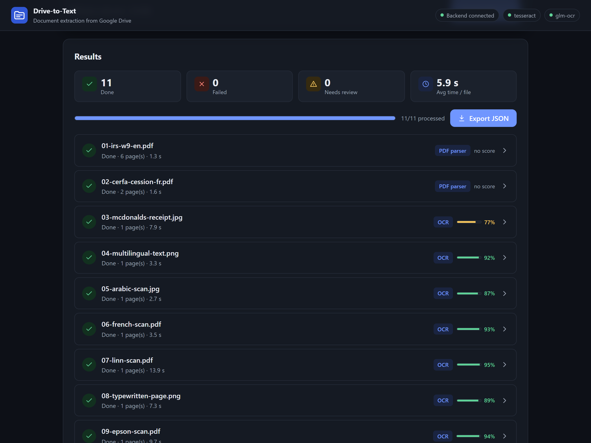
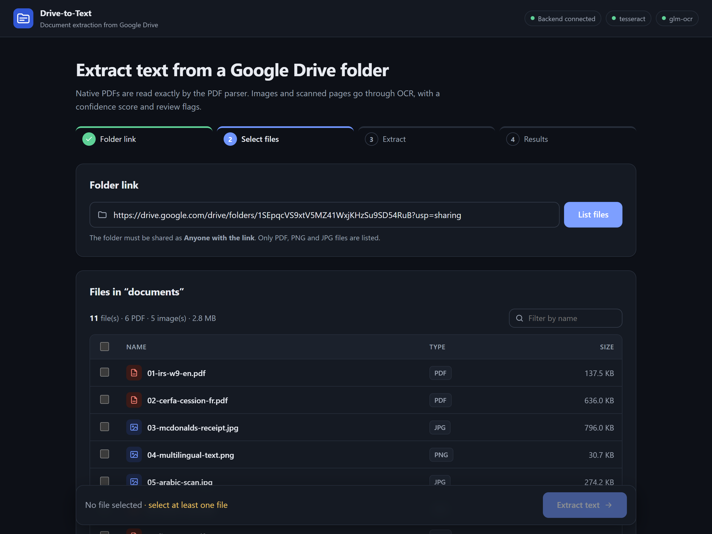
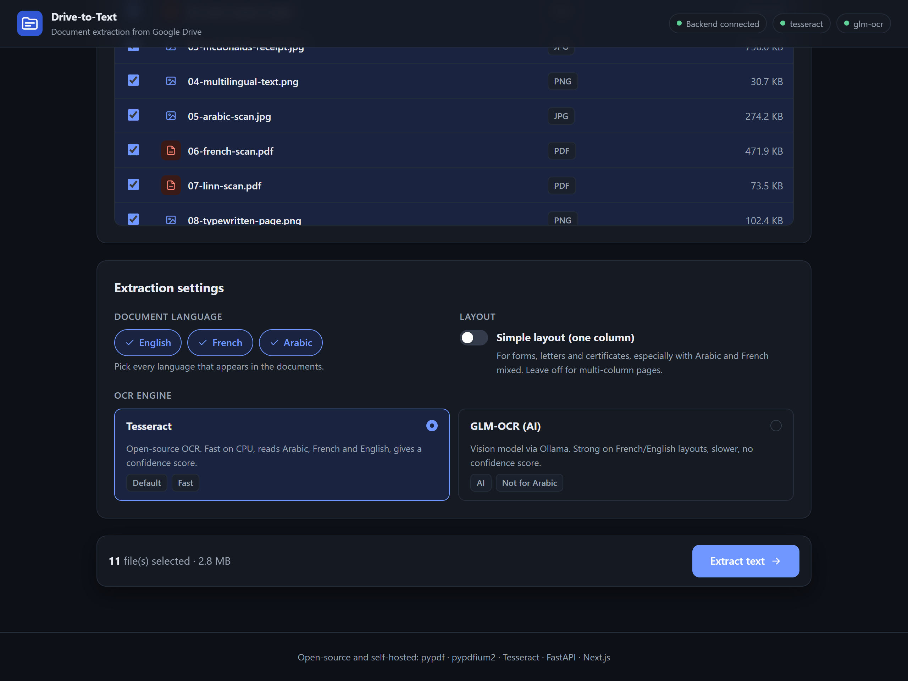
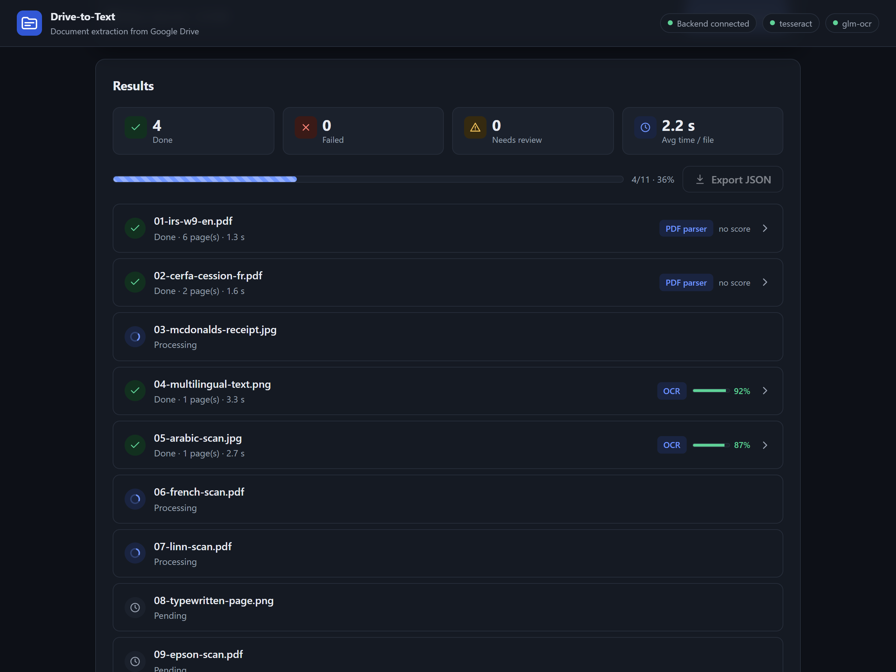
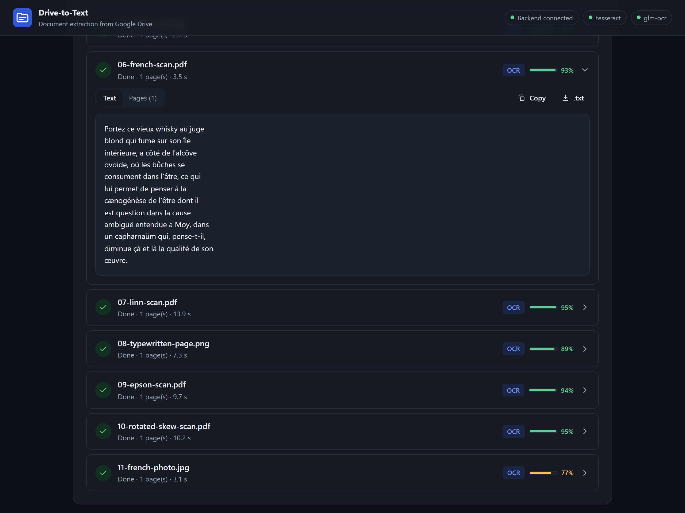

# Drive-to-Text

Paste a public Google Drive folder link, pick the PDFs and images, and get their text back.
Native PDFs are read exactly by a **PDF parser**; images and scanned pages go through **OCR** (Tesseract) with a confidence score. Results show per file and export as JSON.

Proof of concept for the DI Xpertia technical assessment TA-2026-01.



## Features

**Required by the brief**
- Public folder link checked, with a clear message for an invalid, private or missing folder
- PDFs and images (PNG, JPG, JPEG) listed with name, type and size
- Select files one by one or all at once; the selected count stays visible
- Batch processing with a live status per file: *pending*, *processing*, *done*, *failed*
- Results per file with the method used (PDF parser, OCR, or both), plus JSON export
- One failing file never stops the batch

**Bonus items, all done**
- Scanned PDF pages detected and sent to OCR
- Background processing with live progress
- Docker Compose
- Automated tests (97)
- OCR language choice: English, French, Arabic

**Added**
- A confidence score per OCR page and a **"needs review"** flag (confidence under 70, no text found)
- An optional AI OCR engine (GLM-OCR through a local [Ollama](https://ollama.com)), off by default

## Quick start

Needs [Docker](https://docs.docker.com/get-docker/) and a free Google API key.

```bash
git clone https://github.com/medaminmakni/drive-to-text.git
cd drive-to-text
cp .env.example .env        # put your key in GOOGLE_API_KEY
docker compose up --build   # first build takes a few minutes
```

Open **http://localhost:3000** and paste a public folder link, for example our test folder:
`https://drive.google.com/drive/folders/1SEpqcVS9xtV5MZ41WxjKHzSu9SD54RuB`

**Google API key** (2 minutes, no OAuth needed because only public folders are read):
1. [Google Cloud Console](https://console.cloud.google.com/): create or pick a project.
2. *APIs & Services > Library*: enable **Google Drive API**.
3. *APIs & Services > Credentials > Create credentials > API key*.
4. Put it in `.env`. This file is git-ignored.

### Without Docker

```bash
pip install -r requirements-dev.txt
uvicorn app.main:app --port 8000          # API docs: http://localhost:8000/docs

cd web && npm ci && npm run dev           # http://localhost:3000 (second terminal)
```

This needs Python 3.10+, Node 20+ and Tesseract 5 with the `eng`, `fra` and `ara` models
(Linux: `apt install tesseract-ocr-eng tesseract-ocr-fra tesseract-ocr-ara`; Windows: tick the languages in the
[UB Mannheim installer](https://github.com/UB-Mannheim/tesseract/wiki)). A missing language is greyed out in the page.

All settings (limits, OCR resolution, review threshold...) are documented in [.env.example](.env.example). Only the key is required.

## How it works

```
Browser ─► Next.js page (web/, :3000) ─/api/*─► FastAPI (app/, :8000) ─► Google Drive API v3 (list, download)
                                                    │
                                     thread pool, one job per selected file
                                                    │
                       file type from its first bytes (%PDF, PNG, JPEG)
                         ├─ PDF ─► pypdf text layer, page by page
                         │          └─ page with < 20 characters = scanned ─► render (pypdfium2) ─► OCR
                         └─ image ─► OCR (Tesseract)
                                                    │
              status, text, method, confidence per file ─► polled by the page every second ─► JSON export
```

```
app/
  main.py           API routes (contract in docs/API.md)
  batches.py        thread pool and per-file status; a failing file fails alone
  drive/            Drive client: link parsing, listing, download, clear error messages
  extraction/       routing, PDF text layer, page rendering, OCR engines, pipeline
web/src/            one React component per step of the flow, typed API client
tests/              pytest, with fake Google and fake OCR engines (no network needed)
benchmarks/         how the OCR engine was chosen
samples/            JSON exports from real public Drive folders
docs/               API contract and decision log
```

Three ideas keep the code small and testable:
- **OCR engines share one interface**, so Tesseract, an Ollama model or a future engine plug in without changing the pipeline.
- **Dependencies are passed in** (`create_app(settings, drive, engines)`), so tests replace Google and Tesseract with fakes.
- **Errors carry a message for the user**: invalid link, private folder, bad key, quota, damaged or oversized file.

## Technical choices

Each choice is explained, with the alternatives, in [docs/DECISIONS.md](docs/DECISIONS.md).

| Part | Choice | Why |
|---|---|---|
| Backend | Python, FastAPI | Best open-source PDF and OCR tools; validation and API docs built in |
| Web page | Next.js, React, TypeScript | Real state to manage (selection, live progress, results) |
| Drive | Drive API v3 + API key | Official; tells a private folder from an empty one; no login needed |
| PDFs | pypdf + pypdfium2 | Permissive licences; PyMuPDF (AGPL) and Poppler (GPL) avoided |
| OCR | Tesseract 5 | Measured best free option for Arabic + French + English on CPU |
| Progress | Thread pool + polling | Simple and reliable for a POC; no queue to run |
| Run | Docker Compose | Tesseract and its languages installed for you |

## OCR quality, measured

We compared engines on 59 real and generated documents ([benchmarks/](benchmarks/README.md)).
CER = character error rate (lower is better); word F1 = share of the right words found (higher is better).

| Engine | Arabic book pages, CER | French forms, word F1 | Time per page |
|---|---|---|---|
| **Tesseract + upscaling (used)** | **0.08** | **0.77** | 1.4 s (CPU) |
| Tesseract without upscaling | 0.32 | 0.77 | 1.3 s (CPU) |
| GLM-OCR (optional) | 5.21: invents text | 0.18 | 89 s (GPU) |

This changed the app: small images are upscaled before OCR, Arabic is always sent first in the language list, and the AI engine is optional and flagged on Arabic.

## Screenshots

| Folder and file list | Extraction settings |
|---|---|
|  |  |
| **Live progress** | **Extracted text** |
|  |  |

## Sample output

[samples/](samples/) holds JSON exports from two public test folders: 11 documents (native and scanned PDFs, photos, English, French, Arabic) and 2 edge cases (a blank page, a damaged PDF).

## Tests

```bash
python -m pytest -q                            # 97 tests, no network or API key needed
ruff check .                                   # Python lint
cd web && npx tsc --noEmit && npm run lint     # web: types and lint
```

## Known limits

- Public folders only, and only the folder's direct content (sub-folders are skipped).
- Batches are kept in memory: they are lost when the backend restarts.
- One language set per batch. Pick only the languages in the documents.
- Tesseract is weak on handwriting, street photos, complex tables and multi-column reading order.
- Limits per file: 25 MB, 100 PDF pages, 50 megapixels, 60 s of OCR per page.
- Google may briefly refuse downloads after many requests from one network. The app says so; run the batch again a few minutes later.

## Next steps

1. A layout model (PP-DocLayoutV3, Apache-2.0) for the reading order of columns, tables and mixed Arabic + French pages
2. Language detection per file
3. Persistent jobs (queue + database) so batches survive restarts
4. An Arabic OCR model on GPU behind the same engine interface
5. Sub-folders, Google login for private folders, cancelling a batch

## Licence

MIT ([LICENSE](LICENSE)). Every dependency, its version, licence and commercial use is listed in [LICENSES.md](LICENSES.md). No GPL or AGPL component is used.

Commits follow Conventional Commits; each feature was built on its own branch and merged through a pull request.
